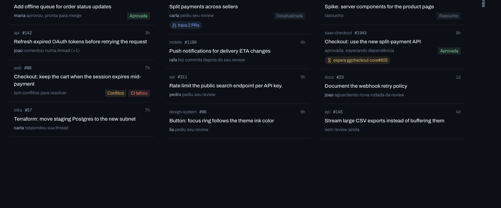
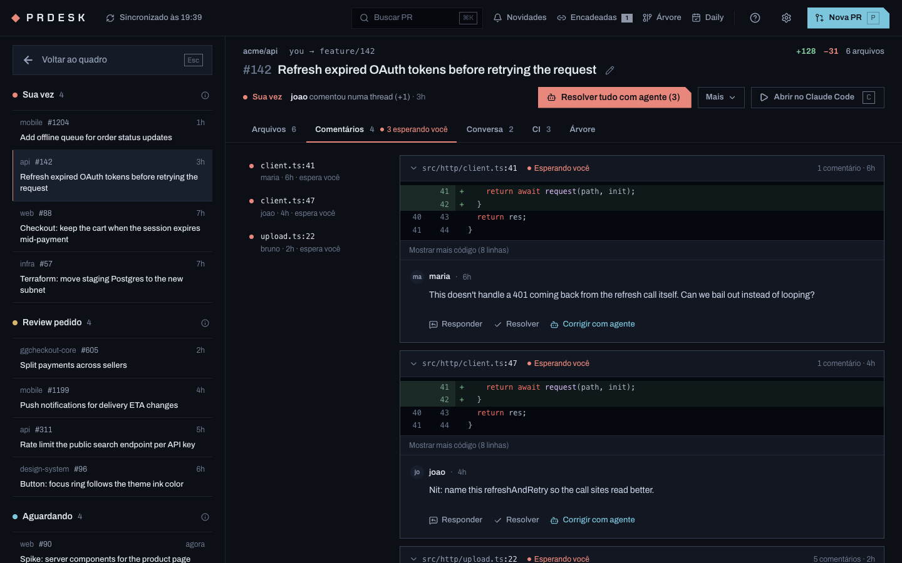

# prdesk

Every open pull request across your repos in one window, sorted by **whose turn it is**. One key hands a PR to your AI agent, running in a ready worktree.

prdesk is a desktop app (macOS, Windows, Linux) built with Tauri. It runs entirely on your machine: no server, no telemetry. Your token stays in the OS keychain.





The UI is in Brazilian Portuguese for now (*Sua vez* = your turn).

## What it does

- **One board, four columns.** *Sua vez* (your turn), *Review pedido* (review requested), *Aguardando* (waiting on others) and *Outras* (everything else in your scopes, folded to a strip). Columns can be reordered, resized and folded.
- **One list, grouped by who holds the ball.** The main view lists your PRs under *Com você*, then one group per person holding one of them, then *Com ninguém* (drafts, nobody asked, waiting on another PR), with the team's PRs folded at the end. Each row says what to do, the PR's title and why, its repo (one fixed colour per repo, also in the sidebar filter) and number, who is involved, and how long it has waited, in amber past one working day. Press `b` for the columns. Light or dark follows the system.
- **Proof next to every status.** Each card shows who acted last and when, plus flags for conflicts, failing CI, drafts and approvals. Press `d` (*Detalhes*) for the detailed cards: a track of the PR's life from opening to now (last commit, each review, open conversations) ending in how long it has sat and with whom, in amber past one working day; who is reviewing and where they stand; its place in a stack of branches, CI still running, and its size.
- **The next step, one click away.** Inside a PR, one highlighted button says what to do now (review the files, resolve everything with the agent, merge, update the branch); the rest lives in *Mais*.
- **Review without leaving the app.** The full diff with line comments and "viewed" marks, review threads with their diff hunk, replies and resolve, the conversation, CI checks with re-run, and the PR's branch tree.
- **Open in your agent.** Pick Claude Code, Codex or OpenCode, or add your own, and press `c`. prdesk clones the repo once into `~/PRDesk`, creates a worktree for the PR's branch, and starts the agent in an embedded terminal with the context already in the prompt. The card shows whether the agent is working or waiting on you, and a notification tells you when it goes quiet.
- **AI on the side.** Analyze a PR (summary, risks, draft comments), draft replies, rewrite descriptions, or describe a task and get a new branch, the agent's work and a written PR.
- **Less to keep in your head.** *Novidades* (GitHub notifications), *Encadeadas* (PRs that declare "Depends on org/repo#123", in merge order), snooze until tomorrow, Monday or the next change, a daily summary to paste, auto-merge once CI passes, and a tray icon with your my-turn count.
- **What happens outside the PRs.** Branches you pushed in the last 14 days without a PR show above the board and open one in a click; a red default branch is flagged so a failing CI elsewhere makes sense; *Issues* lists what is assigned to you, and starting one hands it to the agent with a PR that closes it. The daily summary says where each merged PR is deployed.
- **Fewer trips to GitHub.** Commit a reviewer's suggestion from its thread, re-request review once you pushed the changes, nudge reviewers when a PR sits for days, filter the board by org or repo, ask the people who usually review in a repo straight from a card in *Aguardando* (a draft is marked ready first), and edit labels and assignees or close a PR from *Mais*.
- **Missions across repos.** Describe a change that spans several repos: prdesk prepares a worktree per repo, a headless agent writes `plan.md` with the contract between them, you review it, and one agent per repo starts in parallel. The plan is a plain file under `~/PRDesk/missions/`. See [the design](docs/design/missions.md).
- **Housekeeping.** Settings finds worktrees of closed PRs and removes the ones with nothing unsaved in them.
- **Updates itself.** When a new release is out, a button in the header downloads it, installs it and restarts prdesk. Updates are signed; the app refuses one that was not.

### How "whose turn" is decided

| PR | Your turn when… |
|---|---|
| Yours | an unresolved thread's last comment isn't yours · changes were requested after your last commit · CI is failing · someone commented after your last commit · it's approved (merge it) |
| Someone else's | someone answered a thread you started |

Someone else's PR goes to *Review pedido* when you are a requested reviewer, or when new commits landed after your review.

## Keyboard

| Key | Action |
|---|---|
| `j` / `k` | Next / previous PR |
| `Enter` | Open the highlighted PR |
| `c` | Open the selected PR in the agent |
| `o` | Open the selected PR on GitHub |
| `⌘K` / `Ctrl+K` | Search PRs |
| `n` | Novidades (notifications) |
| `i` | Issues assigned to you |
| `1`–`9` / `0` | Filter the board by repo / show all |
| `p` | New PR with the agent |
| `t` | Branch tree |
| `m` | Missions |
| `r` | Refresh |
| `,` | Settings |
| `?` | Help |
| `Esc` | Close the PR / leave settings |
| `⌘⇧P` / `Ctrl+Shift+P` | Bring prdesk to the front from anywhere |

## Setup

1. Install from the [releases page](../../releases), or build it yourself (below). The builds are not signed yet, so the first launch needs one extra step (see [Opening an unsigned build](#opening-an-unsigned-build)).
2. On first launch, prdesk uses your GitHub CLI token if `gh auth login` was done. Otherwise, paste a token with the `repo` and `read:org` scopes.
3. Add the orgs (`acme`) and repos (`acme/api`) you want to follow. PRs that involve you appear even outside these scopes.

The agent commands are templates: `{prompt}` is replaced by prdesk's instructions. For example, `claude {prompt}` or `opencode --prompt {prompt}`. They run in your login shell, so whatever works in your terminal works here.

Each agent can list the orgs (`acme`) or repos (`acme/api`) it is used for; everywhere else the default agent runs. That is how you keep one Claude account per client: add an agent with `CLAUDE_CONFIG_DIR=~/.claude-client claude {prompt}` (or a shell alias that does the same) and list that client's org. Picking another agent inside a PR overrides it for that repo until prdesk restarts.

### Opening an unsigned build

**macOS.** Drag prdesk to *Applications* and open it. macOS refuses the first time; click *Done* (not *Move to Trash*). Then open *System Settings → Privacy & Security*, scroll to the bottom and click *Open Anyway* next to prdesk. From then on it opens normally. Right-click → *Open* no longer works for this since macOS 15.

If macOS says prdesk "is damaged and can't be opened", the download is only quarantined. Clear the flag and open it again:

```sh
xattr -dr com.apple.quarantine /Applications/prdesk.app
```

**Windows.** On the SmartScreen prompt, choose *More info → Run anyway*.

## Development

Requirements: Rust (stable), Node 22+, pnpm, and the [Tauri prerequisites](https://tauri.app/start/prerequisites/) for your OS.

```sh
pnpm install
pnpm tauri dev          # the app
pnpm dev                # UI only; open http://localhost:1420/?mock for synthetic data, no token needed
pnpm typecheck && pnpm lint && pnpm test
cd src-tauri && cargo fmt --check && cargo clippy --all-targets -- -D warnings && cargo test
```

Architecture in one paragraph: the React UI (`src/`) builds the GraphQL queries and decides whose turn it is (`src/lib/triage.ts`, pure and tested). Rust (`src-tauri/src/`) owns everything that touches secrets or the machine:
- the keychain token (`auth.rs`)
- the GitHub HTTP call (`github.rs`)
- cloning and worktrees (`workspace.rs`)
- the PTY behind the embedded terminal (`pty.rs`)
- headless agent runs for the AI features (`agent.rs`)

The token never reaches the webview.

## Roadmap

- GitLab merge requests
- English UI (today the UI is in Brazilian Portuguese)
- Point at an existing local clone instead of the managed workspace

## Contributing

See [CONTRIBUTING.md](CONTRIBUTING.md).

## License

MIT
